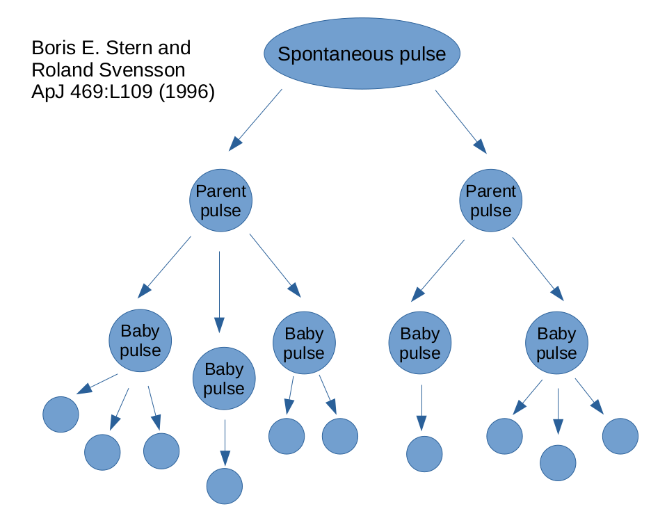

# GeneticGRBs

This repository contains the Python code that implements a Genetic Algorithm (GA) for the optimization of the seven parameters of the [Stern & Svensson (1996)](https://iopscience.iop.org/article/10.1086/310267) (SS96) stochastic pulse avalanche model, for the generation of simulated gamma-ray burst (GRB) light curves (LCs), developed in [this paper](https://www.aanda.org/articles/aa/full_html/2024/09/aa50150-24/aa50150-24.html) ([arXiv version](https://arxiv.org/abs/2403.18754)).

- _Reference Paper_: [Long gamma-ray burst light curves as the result of a common stochastic pulse-avalanche process]().

- _Corresponding Author_: Lorenzo Bazzanini, University of Ferrara ( `bzzlnz[at]unife[dot]it` )

- _Code Contributors_ (in alphabetical order): G. Angora, L. Bazzanini, L. Ferro, C. Guidorzi, and A. Tsvetkova.


## Table of Contents  
- [Description](#description)  
- [Installation](#installation)  
- [Usage](#usage)
  - [Generation of a set of simulated LCs](#generation-of-a-set-of-simulated-lcs)
  - [Running the GA optimization](#running-the-ga-optimization)
- [CNN peak counter](#cnn-peak-counter)
- [Other](#other)


## Description

The light curves of long GRBs show a wide variety of morphologies, which current LC simulation models based on the internal shock paradigm still fail to fully reproduce. The reason is that, despite the recent significant advance in understanding the energetics and dynamics of long GRBs, the nature of their inner engine, how the relativist outflow is powered, and the dissipation mechanisms are still not understood. This limits our ability to properly describe and simulate those transients. 

A promising way to gain insights into these topics is modeling of GRB light curves as the result of a common stochastic process. In the Burst And Transient Source Experiment (BATSE) era, a stochastic pulse avalanche model was proposed and tested by comparing ensemble-average properties of simulated and real light curves, proposed by [SS96](https://iopscience.iop.org/article/10.1086/310267). 

Using machine learning, we optimized this stochastic model's parameters by exploiting the GA's capability to thoroughly explore the parameter space. We revived this model by applying it to two independent datasets, BATSE and Swift/BAT. The average properties are successfully reproduced. Notwithstanding the different populations and passbands of both data sets, the corresponding optimal parameters are interestingly similar. In particular, for both sets the dynamics appears to be close to a critical state, which is key to reproduce the observed variety of time profiles. Our results propel the avalanche character in a critical regime as a key trait of the energy release in GRB engines, which underpins some kind of instability.


<p align="center">

</p>

The GA has been implemented using [`PyGAD`](https://github.com/ahmedfgad/GeneticAlgorithmPython) ([Gad 2023](https://link.springer.com/article/10.1007/s11042-023-17167-y)), a FOSS Python library containing a collection of several machine learning algorithms.

The Python code that implements the SS96 stochastic model is also contained in this repo; it was originally forked from [this public repository](https://github.com/anastasia-tsvetkova/lc_pulse_avalanche) by one of the co-authors, but has undergone significant changes.

To identify the statistically significant peaks in the LCs we have used [`MEPSA`](https://www.fe.infn.it/u/guidorzi/new_guidorzi_files/code.html) ([Guidorzi 2015](https://www.sciencedirect.com/science/article/pii/S2213133715000025)), an algorithm aimed at identifying peaks within a uniformly sampled, background subtracted/detrended time series affected by statistical uncorrelated Gaussian noise, conceived specifically for the analysis of GRB LCs. 


## Installation

To run the code, it is advised to create a self-contained `conda` environment with all the required libraries installed. To create the aformentioned environment (which we called `pygad3`) just run the following four lines of code (or follow the instructions in the file `./conda_pygad3_env.txt`, which contains also the version of _all_ the installed packages):
```bash
# 1. create the conda environment 
conda create -n pygad3 python=3.10

# 2. activate the environment
conda activate pygad3

# 3. install all the required libraries (with the required version)
pip install numpy==1.26.4 matplotlib==3.8.3 seaborn==0.13.2 pandas==2.2.0 astropy==6.0.0 pygad==3.3.1 tqdm==4.66.2 scipy==1.12.0 cloudpickle==3.0.0 h5py==3.10.0 astroml==1.0.2.post1 scikit-learn==1.4.1.post1

# 4. install some extra utilities for VSCode
conda install ipykernel --update-deps --force-reinstall

# 5. install PyTorch (only needed for the CNN peak counter in ./cnn_peak_counter)
pip install torch --index-url https://download.pytorch.org/whl/cpu
```
The CPU build of PyTorch is enough for the CNN peak counter. If you have a CUDA GPU, pick the matching install command from [pytorch.org](https://pytorch.org/get-started/locally/) instead.


## Usage
In order to run the GA minimization procedure, the BATSE or the _Swift_/BAT light curves are needed. Instead, if you just want to simulate a new set of LCs (given a set of seven SS96 parameters) the code in this repository should be sufficient.

#NOTE: before running anything, you have to unzip all the nine archives in the `./lc_pulse_avalanche` folder (seven `swift_errs_*.txt.zip`, `kde_pdf_Swift_peak_count_rates.txt.zip`, and `kde_pdf_BATSE_peak_count_rates.txt.zip`). The two `kde_pdf_*.txt.zip` archives are stored in the repository root, so move them into `./lc_pulse_avalanche` first (`avalanche.py` loads them from there when it is imported). To do that, you can just run the following commands:
```bash
# move the two kde archives next to the swift_errs archives
mv kde_pdf_*_peak_count_rates.txt.zip ./lc_pulse_avalanche/
# move to the right directory
cd ./lc_pulse_avalanche
# extract all the files
tar -xzf swift_errs_1.txt.zip; tar -xzf swift_errs_2.txt.zip; tar -xzf swift_errs_3.txt.zip; tar -xzf swift_errs_4.txt.zip; tar -xzf swift_errs_5.txt.zip; tar -xzf swift_errs_6.txt.zip; tar -xzf swift_errs_7.txt.zip; tar -xzf kde_pdf_Swift_peak_count_rates.txt.zip; tar -xzf kde_pdf_BATSE_peak_count_rates.txt.zip
```

### Generation of a set of simulated LCs

To generate the LCs, edit the `config.ini` file (`./lc_pulse_avalanche/config.ini`) by choosing the instrument (`instrument = batse` or `instrument = swift`, if you want to simulate BATSE or Swift LCs, respectively), the number of LCs (`N_grb = XXX`), and assign the value to the seven SS96 parameters. Make sure that the variable `user` is set to `user='external_user'` at the beginning of both `simulate_GRBs.py` and `statistical_test.py` files. Then run:
```bash
# move to the right directory
cd ./lc_pulse_avalanche
# activate the conda env
conda activate pygad3
# simulate a set of LCs
python simulate_GRBs.py config.ini
```
The code will create a directory (`./simulated_LCs`), and inside, each time you call the code it will create a directory named `Year-Month-Day_Hour_Minute_Second` with all the requested simulated LCs. Moreover, a copy of the config file (`config_Year-Month-Day_Hour_Minute_Second.txt`) will be created in `./simulated_LCs` for later reference.


The value of the optimized parameters (see our paper above) are:
```
# BATSE
mu      = 1.10 
mu0     = 0.91
alpha   = 2.57
delta1  = -1.28
delta2  = 0.28
tau_min = 0.02
tau_max = 40.2

# Swift/BAT
mu      = 1.34
mu0     = 1.16
alpha   = 2.53
delta1  = -0.75
delta2  = 0.27
tau_min = 0.03
tau_max = 56.8
```


### Running the GA optimization
```bash
# move to the right directory
cd ./genetic_algorithm
# set the `user` variable (`geneticgrbs.py`, line 41; `avalanche.py`, `statistical_test.py`)
user={'bach','gravity'}
# set the `instrument` variable (`geneticgrbs.py`, line 98)
instrument={'batse','swift'}
# set the parameters of the model (`geneticgrbs.py`)
{'num_generations','N_grb','range_PARAMS', etc.}
# activate the conda env
conda activate pygad3
# run the GA
python geneticgrbs.py
```


## CNN peak counter

This fork adds a 1D convolutional neural network (`./cnn_peak_counter`) trained on simulated SS96 light curves to predict `n_parent_pulses`, the number of parent (avalanche-triggering) pulses in each LC. It does not need any real BATSE or Swift data: everything runs on LCs produced by `simulate_GRBs.py` or `generate_uniform_bins.py`. See `REPORT.md` for the full write-up of the experiments and results.

Before you start, complete the [Installation](#installation) steps (including PyTorch) and unzip the archives as described in [Usage](#usage). Set `_user = 'external_user'` near the top of `./statistical_test/statistical_test.py`.

### 1. Simulate a training set

Choose one of these two options. Both write to `./simulated_LCs/<run>/` in the repository root, with one `lcN.txt` file per light curve.

**Option A: standard simulation.** Edit `./lc_pulse_avalanche/config.ini` (set `N_grb` and the seven SS96 parameters), then run:
```bash
cd ./lc_pulse_avalanche
python simulate_GRBs.py config.ini
```
With the calibrated parameters, `n_parent_pulses` is heavily skewed toward small values. Note that the shipped `config.ini` is set to `mu0 = 10` for the experiment in `REPORT.md`; change it back to `mu0 = 1.16` to reproduce the calibrated Swift/BAT population.

**Option B: class-balanced dataset.** This option generates exactly `--per-bin` LCs for each `n_parent_pulses` value from 1 to `--max-bin` (default 10). It holds six parameters at the Swift/BAT values and varies only `mu0`:
```bash
cd ./lc_pulse_avalanche
python generate_uniform_bins.py --per-bin 300  --out-dir ../simulated_LCs/uniform_3000
python generate_uniform_bins.py --per-bin 1000 --out-dir ../simulated_LCs/uniform_10000
```

Optionally, plot the simulated LCs (this saves one PNG next to each `lcN.txt`):
```bash
python plot_lcs.py --run-dir ../simulated_LCs/<run> --limit 20
```

### 2. Train the CNN
```bash
cd ./cnn_peak_counter
python train.py --run-dir ../simulated_LCs/<run> --preset fix --out-dir ./runs
```
If you leave out `--run-dir`, the most recently modified directory in `./simulated_LCs` is used. The main options are:

| Option | Default | Meaning |
|---|---|---|
| `--preset` | none | Sets `--sampler` and `--loss` together: `baseline` (uniform + MSE), `poisson-only` (uniform + Poisson), `fix` (balanced + Poisson), `mse-weighted` (balanced + MSE) |
| `--sampler` | `balanced` | `balanced` = inverse-class-frequency weighted sampling; `uniform` = plain shuffling |
| `--loss` | `poisson` | `poisson` (Poisson NLL) or `mse` |
| `--cap-per-class` | none | Undersample so that each class has at most this many LCs |
| `--epochs`, `--batch-size`, `--lr` | 25, 32, 1e-3 | Training hyperparameters |
| `--val-frac`, `--test-frac` | 0.15, 0.15 | Fractions held out for validation and testing |
| `--seed` | 42 | Seed for the train/val/test split |
| `--live-plot` | off | Shows live loss and accuracy curves (needs a display) |

The script writes `best_model.pt` (the best checkpoint on validation), `test_split.npz` (the held-out test set) and `history.csv` (per-epoch metrics) to `--out-dir`.

### 3. Evaluate on the held-out test set
```bash
python validate.py --run-dir ./runs
```
This loads `best_model.pt` and `test_split.npz` from `--run-dir`, prints the test metrics, and saves `pulse_count_distribution.png` (true vs. predicted pulse counts) and `prediction_error_histogram.png` in the same directory.


## Other
If you have any question or you are interested in contributing do not hesitate to contact the authors.

Please cite the following associated paper if you use this code in your work:
```
@ARTICLE{2024A&A...689A.266B,
       author = {{Bazzanini}, L. and {Ferro}, L. and {Guidorzi}, C. and {Angora}, G. and {Amati}, L. and {Brescia}, M. and {Bulla}, M. and {Frontera}, F. and {Maccary}, R. and {Maistrello}, M. and {Rosati}, P. and {Tsvetkova}, A.},
        title = "{Long gamma-ray burst light curves as the result of a common stochastic pulse{\textendash}avalanche process}",
      journal = {\aap},
     keywords = {methods: statistical, gamma-ray burst: general, Astrophysics - High Energy Astrophysical Phenomena, Astrophysics - Instrumentation and Methods for Astrophysics},
         year = 2024,
        month = sep,
       volume = {689},
          eid = {A266},
        pages = {A266},
          doi = {10.1051/0004-6361/202450150},
archivePrefix = {arXiv},
       eprint = {2403.18754},
 primaryClass = {astro-ph.HE},
       adsurl = {https://ui.adsabs.harvard.edu/abs/2024A&A...689A.266B},
      adsnote = {Provided by the SAO/NASA Astrophysics Data System}
}
```
